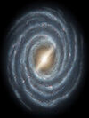
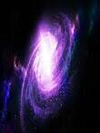

# 🃏 Memorama gráfico

**Programación I · Segundo parcial**

[🏠 Inicio](../../README.md) › [Programación I](../README.md) › **Memorama gráfico**

---

## 📌 Enunciado

Construir un programa que permita a **dos jugadores** jugar *Concéntrese* (memorama):

- 🔍 Hay que recordar dónde están las parejas de figuras, ocultas bajo un recuadro.
- 👆 Al seleccionar un recuadro se muestra una de las imágenes.
- 🎯 El objetivo es encontrar su pareja.
- 🔁 Cuando se completan todos los recuadros el juego termina y se puede iniciar uno nuevo con los mismos jugadores.

## 🖼️ Las cartas

## 🗂️ Archivos

| Archivo | Contenido |
| :--- | :--- |
| [`Memorama-santiagoTorifaManso.rkt`](Memorama-santiagoTorifaManso.rkt) | Lógica e interfaz del juego. |
| [`IMAGENES/`](IMAGENES) | Cartas, reverso, logo y pantalla final. |

## ▶️ Cómo ejecutarlo

Abre el `.rkt` en **DrRacket** desde esta carpeta (para que encuentre `IMAGENES/`) y presiona **Run**.

<a href="../README.md">⬅ Volver a Programación I</a>

