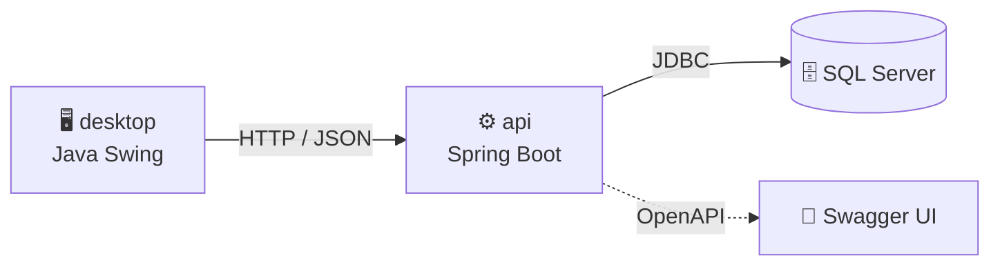

<div align="center">

# ✨ Glow Harmony

**Programación IV · Proyecto de semestre**

*Sistema de gestión de inventario con método Kardex*


</div>

[🏠 Inicio](../../README.md) › [Programación IV](../README.md) › **Glow Harmony**

---

## 📌 Descripción

**Glow Harmony** es un sistema de gestión de inventario compuesto por una **API REST** y una **aplicación de escritorio** que la consume.

| | Funcionalidad | Detalle |
| :-: | :--- | :--- |
| 📒 | **Método Kardex** | Seguimiento interno del movimiento de cada producto. |
| 👥 | **Manejo de usuarios** | Soporte para dos roles diferentes. |
| 🏷️ | **Gestión de productos** | Registro y edición de productos y proveedores. |
| 🔄 | **Entradas y salidas** | Registro de compras y ventas que actualizan el inventario. |
| ⚠️ | **Mínimos** | Vista de productos que alcanzan su stock mínimo. |
| 🗄️ | **Base de datos** | Microsoft SQL Server como almacenamiento. |

## 🏗️ Arquitectura



## 🗂️ Estructura

```text
Glow._.Harmony_Managament/
├── api/                       # API REST (Spring Boot)
│   └── src/main/java/com/api/
│       ├── core/              # Configuración, entorno, Swagger y base de datos
│       └── routes/            # auth, users, products, suppliers, inventory, ...
│           └── <recurso>/     # dtos · builders · sql · usecases
└── desktop/                   # Cliente de escritorio (Swing)
    └── src/main/java/com/desktop/
        ├── core/              # Navegación, servicios y utilidades
        └── views/             # login, products, inventory, suppliers, users, ...
```

## ▶️ Cómo ejecutarlo

**Requisitos:** JDK 22, Maven y una instancia de SQL Server.

### 1. API

Crea un archivo `.env` dentro de `api/` con las variables de conexión:

```env
DB_URL=jdbc:sqlserver://localhost:1433;databaseName=<base_de_datos>;encrypt=false
DB_USERNAME=<usuario>
DB_PASSWORD=<contraseña>
DB_DRIVER_CLASS_NAME=com.microsoft.sqlserver.jdbc.SQLServerDriver
```

Y levanta el servidor:

```bash
cd api
./mvnw spring-boot:run
```

### 2. Aplicación de escritorio

Con la API corriendo, ejecuta la clase `com.desktop.Main` desde tu IDE o:

```bash
cd desktop
mvn compile exec:java -Dexec.mainClass=com.desktop.Main
```

<div align="center"><sub><a href="../README.md">⬅ Volver a Programación IV</a></sub></div>
