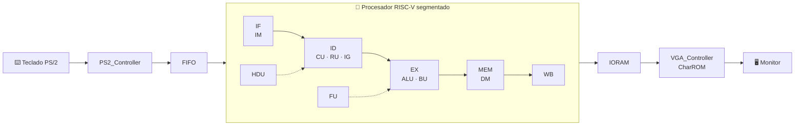

<div align="center">

# 🧠 Computador RISC‑V

**Arquitectura de Computadores · Proyecto final**

*Procesador RISC‑V segmentado con video VGA y teclado PS/2 sobre FPGA*


</div>

[🏠 Inicio](../../README.md) › [Arquitectura de Computadores](../README.md) › **Computador RISC‑V**

---

## 📌 Descripción

Un computador completo descrito en **SystemVerilog**: un procesador **RISC‑V** con *pipeline* que ejecuta programas desde memoria, recibe caracteres desde un **teclado PS/2** y los muestra en un monitor **VGA**.

## 🏗️ Arquitectura



## 🧩 Módulos

| Módulo | Nombre | Función |
| :---: | :--- | :--- |
| `ALU` | Unidad aritmético‑lógica | Operaciones aritméticas, lógicas y de desplazamiento. |
| `BU` | Branch Unit | Evalúa las condiciones de los saltos. |
| `CU` | Control Unit | Genera las señales de control a partir de la instrucción. |
| `RU` | Register Unit | Banco de 32 registros. |
| `IG` | Immediate Generator | Extiende inmediatos de los formatos I, S, B, U y J. |
| `IM` | Instruction Memory | Memoria de instrucciones. |
| `DM` | Data Memory | Memoria de datos. |
| `HDU` | Hazard Detection Unit | Detecta riesgos *load‑use* y detiene el pipeline. |
| `FU` | Forwarding Unit | Reenvía resultados para evitar paradas innecesarias. |
| `FIFO` | Cola | Almacena las teclas recibidas. |
| `IOM` | I/O Memory | Memoria mapeada para entrada/salida. |
| `PS2` | Controlador PS/2 | Lee los *scancodes* del teclado. |
| `VGA` | Controlador VGA | Genera la señal de video y dibuja caracteres con `CharROM`. |

## 🗂️ Estructura

```text
ProyectoFinal-Computador/
├── computer/              # Computador final
│   ├── RISCV_Computer.sv  # Módulo tope (top-level)
│   ├── ALU/ BU/ CU/ DM/ FIFO/ FU/ HDU/ IG/ IM/ IOM/ RU/
│   ├── PS2/ VGA/          # Periféricos
│   └── MemoryIO.mif       # Contenido inicial de memoria
└── inputoutput/           # Prototipo de entrada/salida (PS/2 → VGA)
```

## ▶️ Cómo ejecutarlo

1. Crea un proyecto en **Intel Quartus Prime** para tu tarjeta FPGA.
2. Agrega los archivos de `computer/` y define `RISCV_Computer` como entidad tope.
3. Asigna los pines de reloj (50 MHz), PS/2 y VGA según tu tarjeta.
4. Compila, programa la FPGA y conecta un teclado y un monitor.

<div align="center"><sub><a href="../README.md">⬅ Volver a Arquitectura de Computadores</a></sub></div>
