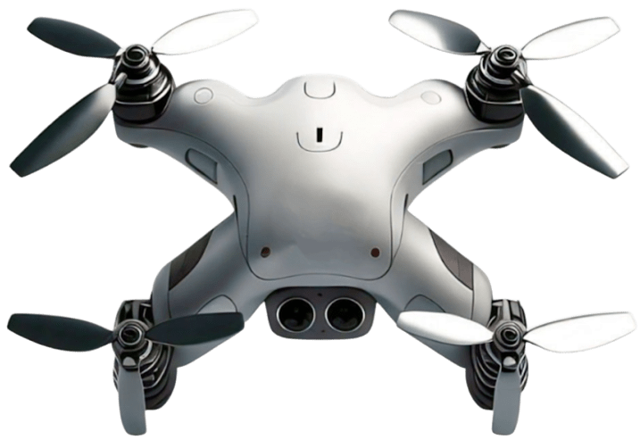

<div align="center">


# 🐱 Kitty Skies

**Computación Gráfica · Proyecto final**

*Un juego estilo flappy con gatitos, drones y nuevos retos*


</div>

[🏠 Inicio](../../README.md) › [Computación Gráfica](../README.md) › **Kitty Skies**

---

## 🎮 Sobre el juego

Inspirado en los juegos de tipo *flappy*, pero con su propia temática: guía a **Kitty** a través del cielo esquivando obstáculos.

- ⬆️ Presiona **Espacio** para aletear.
- 🧱 Cada obstáculo superado suma un punto.
- 🚁 Al llegar a **25 puntos** comienza el **nivel 2**: aparece un dron que dispara.
- 🎵 Incluye música de fondo y efectos de sonido.

<div align="center">

&nbsp;&nbsp;

&nbsp;&nbsp;

</div>

## 🗂️ Estructura

| Archivo / carpeta | Contenido |
| :--- | :--- |
| [`main.py`](main.py) | Bucle del juego, entidades, menús y niveles. |
| [`contants/parameters.py`](contants/parameters.py) | Parámetros: pantalla, gravedad, fuerza de aleteo, obstáculos… |
| [`assets/`](assets) | Sprites, fondos, música y efectos. |

## ▶️ Cómo ejecutarlo

```bash
pip install -r requirements.txt
python main.py
```

> [!NOTE]
> Ejecútalo desde esta carpeta para que encuentre `assets/`.

<div align="center"><sub><a href="../README.md">⬅ Volver a Computación Gráfica</a></sub></div>
