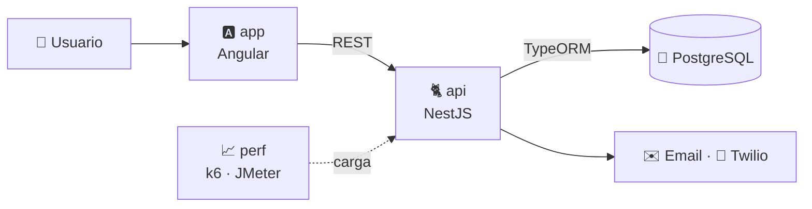

# 🛍️ Alkosto — HamKov Engineers

**Ingeniería de Software I · Proyecto de semestre**

*E‑commerce full‑stack inspirado en la tienda Alkosto*

[🏠 Inicio](../../README.md) › [Ingeniería de Software I](../README.md) › **Alkosto**

---

## 📌 Descripción

Proyecto realizado en equipo (**HamKov Engineers**) para la asignatura de Ingeniería de Software I: una tienda en línea con frontend en **Angular**, backend en **NestJS** sobre **PostgreSQL** y pruebas de rendimiento con **k6** y **JMeter**.

## ✨ Funcionalidades

| | Funcionalidad |
| :-: | :--- |
| 🏠 | Página de inicio y catálogo de productos |
| 🔎 | Búsqueda en vivo mientras el usuario escribe |
| 📄 | Vista de detalle de producto |
| 🛒 | Carrito de compras |
| 🔐 | Registro, inicio de sesión y cambio de contraseña |
| ✉️ | Verificación por correo y códigos OTP por SMS / WhatsApp (Twilio) |
| 👤 | Perfil de usuario |
| 📍 | Nuestras tiendas y página de ayuda |

## 🏗️ Arquitectura

## 🗂️ Estructura

| Carpeta | Contenido |
| :--- | :--- |
| [`app/`](app) | Frontend en Angular (páginas, componentes y servicios). |
| [`api/`](api) | Backend en NestJS: módulos `auth`, `users`, `products` y `shopping-cart`. |
| [`perf/`](perf) | Pruebas de carga que simulan a un usuario escribiendo en el buscador. |

## ▶️ Cómo ejecutarlo

Consulta el README de cada parte:

1. [⚙️ API](api/README.md) — configurar variables de entorno y levantar el servidor.
2. [🅰️ App](app/README.md) — levantar el frontend.
3. [📈 Perf](perf/README.md) — ejecutar las pruebas de rendimiento.

<a href="../README.md">⬅ Volver a Ingeniería de Software I</a>

