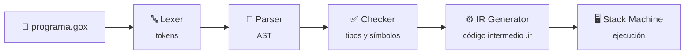

<div align="center">

# 👀 GOX Compiler

**Compiladores · Proyecto de semestre**

*Compilador e intérprete para el lenguaje GOX, escrito en Python*


</div>

[🏠 Inicio](../../README.md) › [Compiladores](../README.md) › **GOX Compiler**

---

## 📌 Descripción

**GOX** es un lenguaje imperativo sencillo con variables, constantes, funciones, condicionales, ciclos, acceso directo a memoria y tipos `int`, `float`, `char` y `bool`. Este proyecto implementa todas las fases necesarias para llevar un programa `.gox` desde el texto fuente hasta su ejecución.

## 🔄 Fases del compilador



| Fase | Archivo | Qué hace |
| :--- | :--- | :--- |
| Análisis léxico | [`lexer.py`](src/compiler/code_analyzer/lexer.py) | Convierte el código fuente en tokens. |
| Análisis sintáctico | [`parser.py`](src/compiler/code_analyzer/parser.py) | Construye el árbol de sintaxis abstracta (AST). |
| Análisis semántico | [`checker.py`](src/compiler/code_analyzer/checker.py) | Verifica tipos, alcances y tabla de símbolos. |
| Código intermedio | [`ir_generator.py`](src/compiler/interpreter/ir_generator.py) | Genera la representación intermedia. |
| Ejecución | [`stack_machine.py`](src/compiler/interpreter/stack_machine.py) | Interpreta el IR en una máquina de pila. |

## ✍️ Un vistazo a GOX

```go
/* Compute fibonacci numbers */

var a int = 1;
var b int = 1;
var t int;
var n int = 0;
const LAST = 20;

while n < LAST {
    print a;
    t = a + b;
    a = b;
    b = t;
    n = n + 1;
}
```

En [`code/`](code) hay más ejemplos: factoriales, factorización, pruebas de tipos, manejo de memoria… y hasta el **conjunto de Mandelbrot** (`mandel.gox`, `mandelplot.gox`).

## 📝 Instalación

> [!NOTE]
> Las instrucciones usan un entorno de **Miniconda** para aislar dependencias. Si ya tienes Python 3 con las librerías de `requirements.txt`, puedes saltarte los pasos 1 a 3.

1. **Instalar Miniconda** desde [docs.conda.io](https://docs.conda.io/en/latest/miniconda.html).

2. **Crear el entorno virtual**

   ```bash
   conda create --name gox-compiler python=3
   ```

3. **Activarlo**

   ```bash
   conda activate gox-compiler
   ```

4. **Instalar las dependencias** desde la raíz del proyecto

   ```bash
   pip install -r requirements.txt
   ```

## 🎬 Ejecución

Desde la raíz del proyecto:

```bash
python __main__.py <ruta del archivo .gox>
```

Por ejemplo:

```bash
python __main__.py ./code/factorize.gox
```

## 🗂️ Documentación

| Documento | Contenido |
| :--- | :--- |
| 📘 [`DOCUMENTATION.md`](docs/DOCUMENTATION.md) | Funcionamiento del código, problemas encontrados y sus soluciones. |
| 📐 [`GOX_GRAMMAR.md`](docs/GOX_GRAMMAR.md) | Gramática formal del lenguaje GOX. |
| 🏷️ [`VERSIONS.md`](docs/VERSIONS.md) | Historial de versiones del proyecto. |

## 👥 Equipo

- Santiago Torifa Manso
- Mariana Tellez Gutierrez
- Katherin Tatiana Ocampo

<div align="center"><sub><a href="../README.md">⬅ Volver a Compiladores</a></sub></div>
