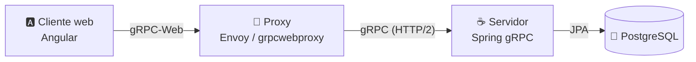

<div align="center">

# 💳 gRPC Bank

**Sistemas Distribuidos · Proyecto**

*Sistema bancario distribuido con gRPC, gRPC‑Web y streaming en tiempo real*


</div>

[🏠 Inicio](../../README.md) › [Sistemas Distribuidos](../README.md) › **gRPC Bank**

---

## 📌 Descripción

Un banco simplificado en el que **cliente y servidor se comunican exclusivamente por gRPC**. El servidor expone servicios definidos con Protocol Buffers y el cliente web los consume a través de un proxy **gRPC‑Web**. Las transacciones de una cuenta y el saldo total del banco se transmiten en **streaming** a medida que cambian.

## 🏗️ Arquitectura



## 📡 Servicios gRPC

Definidos en [`bank.proto`](server/grpc/src/main/proto/bank.proto):

| Servicio | RPCs |
| :--- | :--- |
| 👤 `UserService` | `GetUser` · `ListUsers` · `CreateUser` |
| 🔐 `AuthService` | `Login` |
| 🏦 `AccountService` | `ListAccounts` · `CreateAccount` · `GetAccountByUser` |
| 💸 `TransactionService` | `ListTransactions` · `CreateTransaction` · `StreamAccountTransactions` 🔴 |
| 📊 `BankService` | `GetBankTotal` · `StreamBankTotal` 🔴 |

<sub>🔴 = *server streaming*: el servidor envía actualizaciones continuas al cliente.</sub>

## 🗂️ Estructura

```text
grpc-bank/
├── server/grpc/                     # Servidor Spring Boot + Spring gRPC
│   ├── envoy.yaml                   # Configuración del proxy gRPC-Web
│   └── src/main/
│       ├── proto/bank.proto         # Contrato de servicios
│       ├── java/com/santiago/grpc/
│       │   ├── domain/entity/       # User, Account, Transaction
│       │   ├── repository/          # Repositorios JPA
│       │   ├── service/             # Implementación de los servicios gRPC
│       │   ├── mapper/              # Entidades ⇄ mensajes Protobuf
│       │   └── util/                # Arranque del proxy gRPC-Web, tipos
│       └── resources/application.yaml
└── client/web/                      # Cliente Angular
    ├── proto/bank.proto
    └── src/app/
        ├── grpc/                    # Código generado por protoc
        ├── services/                # Clientes gRPC por servicio
        └── pages/                   # login · register · dashboard · transactions · user-account
```

## ▶️ Cómo ejecutarlo

**1. Servidor** — define las variables de conexión a PostgreSQL y ejecuta:

```bash
export DB_URL="jdbc:postgresql://<host>:5432/<base_de_datos>?sslmode=require"
export DB_USERNAME="<usuario>"
export DB_PASSWORD="<contraseña>"

cd server/grpc
./mvnw spring-boot:run
```

**2. Proxy gRPC‑Web** — los navegadores no hablan gRPC directamente. Levanta [Envoy](https://www.envoyproxy.io/) con [`envoy.yaml`](server/grpc/envoy.yaml) o instala `grpcwebproxy`. El cliente espera el proxy en `http://localhost:8081` (`envoy.yaml` escucha en el `8080`, así que ajusta uno de los dos si usas Envoy).

**3. Cliente web**

```bash
cd client/web
npm install
npm start                # http://localhost:4200
npm run generate:grpc    # (opcional) regenerar el código a partir de bank.proto
```

<div align="center"><sub><a href="../README.md">⬅ Volver a Sistemas Distribuidos</a></sub></div>
