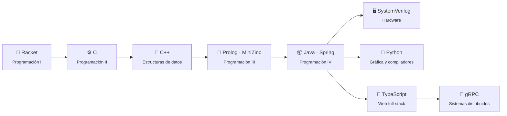

<div align="center">



<br/>

[](LICENSE)
[](https://github.com/Krosbift/UTP/commits/main)
[](https://github.com/Krosbift/UTP)
[](https://github.com/Krosbift/UTP)

**Mi recorrido por la carrera de Ingeniería de Sistemas y Computación en la<br/>Universidad Tecnológica de Pereira, contado a través del código.**

[Asignaturas](#-asignaturas) ·
[Proyectos destacados](#-proyectos-destacados) ·
[Tecnologías](#-tecnologías) ·
[Estructura](#-estructura-del-repositorio) ·
[📚 Wiki](https://github.com/Krosbift/UTP/wiki) ·
[Licencia](#-licencia)

</div>

---

## 👋 Sobre este repositorio

Este fue **mi primer repositorio**. Aquí guardo los códigos fuente que yo, **Santiago Torifa Manso**, he desarrollado para trabajos, tareas, parciales y proyectos finales de las asignaturas de programación (y afines) de la carrera.

Está organizado **por asignatura**: cada carpeta lleva el código oficial de la materia (`IS105`, `IS284`, …) y dentro encontrarás cada proyecto con su propio `README` explicando el enunciado, la estructura y cómo ejecutarlo.

> [!TIP]
> Si tienes poco tiempo, empieza por los [proyectos destacados](#-proyectos-destacados). Si quieres ver la evolución completa, recorre las [asignaturas](#-asignaturas) en orden: del primer laberinto en Racket a un banco distribuido con gRPC.

---

## 📚 Asignaturas

| Código | Asignatura | Proyectos | Tecnologías |
| :----: | :--------- | :-------- | :---------- |
| **IS105** | [🧩 Programación I](IS105-Programacion-I) | Laberinto ASCII · Memorama · Resonancia magnética · Ajedrez |  |
| **IS284** | [⚙️ Programación II](IS284-Programacion-II) | Rush/Plural · Resonancia magnética · Desencriptadora · Sistema de graficación |   |
| **IS304** | [🌳 Estructura de Datos](IS304-EstructuraDeDatos) | 9 estructuras + algoritmo de Karger |  |
| **IS453** | [🧠 Programación III](IS453-Programacion-III) | Ejercicios de lógica y restricciones |   |
| **IS553** | [📦 Programación IV](IS553-Programacion-IV) | Glow Harmony — gestión de inventario |    |
| **IS614** | [🖥️ Arquitectura de Computadores](IS614-ArquitecturaDeComputadores) | Computador RISC‑V con VGA y teclado PS/2 |   |
| **IS623** | [🎨 Computación Gráfica](IS623-ComputacionGrafica) | Procesador de imágenes · Kitty Skies |    |
| **IS634** | [⏰ Electrónica Digital](IS634-ElectronicaDigital) | Reloj digital con alarma y temporizador |   |
| **IS714** | [🛒 Ingeniería de Software I](IS714-IngenieriaDeSoftware-I) | Alkosto — e‑commerce full‑stack |    |
| **IS734** | [☕ Sistemas Operativos](IS734-SistemasOperativos) | Love Coffe — mini juego web |   |
| **IS753** | [🔤 Compiladores](IS753-Compiladores) | GOX Compiler — léxico, sintaxis, semántica e IR |  |
| **IS983** | [🏦 Sistemas Distribuidos](IS983-SistemasDistribuidos) | gRPC Bank — banca con streaming en tiempo real |    |

---

## ⭐ Proyectos destacados

<table>
  <tr>
    <td width="50%" valign="top">
      <h3>🔤 <a href="IS753-Compiladores/GOX-Compiler">GOX Compiler</a></h3>
      <p>Compilador completo para el lenguaje <b>GOX</b>: analizador léxico, parser con AST, verificación semántica, generación de código intermedio y una máquina de pila que lo ejecuta. ¡Incluso dibuja el conjunto de Mandelbrot!</p>
      <code>Python</code> <code>Compiladores</code> <code>AST</code>
    </td>
    <td width="50%" valign="top">
      <h3>🖥️ <a href="IS614-ArquitecturaDeComputadores/ProyectoFinal-Computador">Computador RISC‑V</a></h3>
      <p>Procesador RISC‑V segmentado descrito en hardware, con unidad de forwarding, detección de riesgos, memoria, salida <b>VGA</b> y entrada por <b>teclado PS/2</b> sobre FPGA.</p>
      <code>SystemVerilog</code> <code>RISC‑V</code> <code>FPGA</code>
    </td>
  </tr>
  <tr>
    <td width="50%" valign="top">
      <h3>🏦 <a href="IS983-SistemasDistribuidos/grpc-bank">gRPC Bank</a></h3>
      <p>Sistema bancario distribuido: servidor <b>Spring gRPC</b> + PostgreSQL, proxy gRPC‑Web y cliente <b>Angular</b> con transacciones y saldo total del banco transmitidos en <i>streaming</i>.</p>
      <code>gRPC</code> <code>Java</code> <code>Angular</code>
    </td>
    <td width="50%" valign="top">
      <h3>🛒 <a href="IS714-IngenieriaDeSoftware-I/alkosto">Alkosto</a></h3>
      <p>Réplica de e‑commerce con catálogo, búsqueda en vivo, carrito, autenticación y verificación por correo/SMS. Incluye pruebas de carga con <b>k6</b> y <b>JMeter</b>.</p>
      <code>Angular</code> <code>NestJS</code> <code>PostgreSQL</code>
    </td>
  </tr>
  <tr>
    <td width="50%" valign="top">
      <h3>♟️ <a href="IS105-Programacion-I/ProyectoFinal-AjedrezGrafico">Ajedrez gráfico</a></h3>
      <p>Mi proyecto final del primer semestre: ajedrez para dos jugadores con interfaz gráfica, jaque, jaque mate y coronación de peón.</p>
      <code>Racket</code> <code>GUI</code>
    </td>
    <td width="50%" valign="top">
      <h3>📦 <a href="IS553-Programacion-IV/Glow._.Harmony_Managament">Glow Harmony</a></h3>
      <p>Gestión de inventario con método <b>Kardex</b>: API REST en Spring Boot documentada con Swagger y cliente de escritorio en Java Swing.</p>
      <code>Java</code> <code>Spring Boot</code> <code>Swing</code>
    </td>
  </tr>
</table>

---

## 🛠️ Tecnologías

<div align="center">

**Lenguajes**


**Frameworks y librerías**


**Datos, infraestructura y pruebas**


</div>

### 📈 La evolución, en un vistazo



---

## 🗂️ Estructura del repositorio

```text
UTP/
├── IS105-Programacion-I/                 # Racket: juegos y simulaciones con GUI
├── IS284-Programacion-II/                # C: archivos, cifrado y graficación con SDL2
├── IS304-EstructuraDeDatos/              # C++: estructuras de datos genéricas
├── IS453-Programacion-III/               # Prolog y MiniZinc
├── IS553-Programacion-IV/                # Java: API Spring Boot + cliente Swing
├── IS614-ArquitecturaDeComputadores/     # SystemVerilog: computador RISC-V
├── IS623-ComputacionGrafica/             # Python: procesamiento de imágenes y videojuego
├── IS634-ElectronicaDigital/             # SystemVerilog: reloj digital en FPGA
├── IS714-IngenieriaDeSoftware-I/         # Angular + NestJS: e-commerce
├── IS734-SistemasOperativos/             # Astro: mini juego web
├── IS753-Compiladores/                   # Python: compilador del lenguaje GOX
├── IS983-SistemasDistribuidos/           # gRPC: banco distribuido
├── LICENSE
└── README.md
```

Cada asignatura tiene su propio `README.md` con el listado de proyectos, y cada proyecto incluye:

- 📌 **Descripción / enunciado** — qué se pidió resolver.
- 🗂️ **Estructura** — cómo está organizado el código.
- ▶️ **Cómo ejecutarlo** — requisitos y comandos.

---

## 📄 Licencia

Distribuido bajo la licencia **MIT**. Consulta el archivo [`LICENSE`](LICENSE) para más información.

<div align="center">

<br/>

Hecho con ☕ y muchas noches de parcial por **[Santiago Torifa Manso](https://github.com/Krosbift)**<br/>
<sub>Universidad Tecnológica de Pereira · Ingeniería de Sistemas y Computación</sub>

</div>
